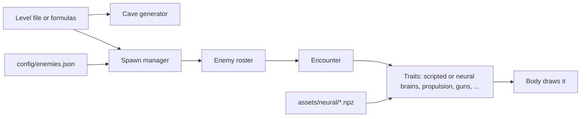

# How Squiddler fits together

Squiddler is a pygame game with one big idea in its code: **every creature is assembled, not programmed**. A Jelly, a Wallcrawler, a boss and even your hunter ally are each a *Body* (how it looks) plus a list of *Traits* (what it does). Some of those traits are hand-written behaviours. Others hand control to a trained neural network.



## A frame of the game

`main.py` opens the window and hands over to `Game` (`game.py`). Every frame, `Game`:

1. reads input and flies the player's `Ship` (`entities/ship.py`);
2. steps the **Encounter**, which runs every creature's traits in order;
3. resolves shots, contacts and explosions (`game_handlers/collision_handler.py`);
4. updates the score, the stars and the power gauge (`scoring/`);
5. draws the cave, the creatures, the HUD and the effects (`rendering/`).

## Levels and caves

What's on a level comes from `level_config.py`: the level's file in `levels/` if it has one, otherwise the formulas in `level_rules.py` (see [levels/README.md](levels/README.md)). `maze/` turns that into a cave of rock blocks, drawn and collided as smooth curved walls, which shots can break a block at a time. `SpawnManager` builds each enemy and adds it to the `EnemyRoster`.

## Creatures

Each kind of creature is one entry in `config/enemies.json`. Here is the Belemnite, an exploding squid, assembled entirely from existing parts:

```json
"belemnite": {
  "body": "belemnite",
  "allegiance": "enemy",
  "traits": {
    "chase": {}, "drift": {"speed": "aggressive_speed"}, "bouncesOffWalls": {},
    "ramsShip": {}, "takesHits": {"hitPoints": 3}, "dropsPickup": {},
    "explodes": {"reach": 7.0, "damage": 3, "push": 7.0, "wallHits": 1, "fuse": 8.0},
    "keepsApart": {"crowd": "chasers"}
  }
}
```

- A **Creature** (`creatures/creature.py`) holds what every creature has: position, velocity, hit points, allegiance, this frame's controls, and whatever state its traits keep. It does nothing by itself.
- A **Trait** (`creatures/traits/`) is one behaviour, written to be reusable: a brain decides the controls, propulsion turns controls into motion, and combat traits handle guns, hits and explosions. Traits talk to each other and to the Body through the controls and through events such as `fired`, `hit` and `died`.
- A **Body** (`entities/`) animates and draws the creature and plays its death. It never decides anything.
- The **Encounter** (`creatures/encounter.py`) runs the creatures each frame, offers them the player's shots, and gives traits the world they act on: the ship, the hunter, the maze, and a way to spawn, kill and explode.

`creatures/registry.py` checks the whole catalogue when the game starts, so a misspelt trait or a missing parameter stops the game immediately rather than mid-level.

## Brains

A brain is the trait that decides a creature's controls.

- **Scripted brains** (`creatures/traits/brains.py`, `flock.py` and others) are plain code: chase, patrol, sit still, flock.
- **Neural brains** drive the Jellies, Flockers, Wallcrawlers and Inchworms. At startup `Game` loads each trained network from `assets/neural/` (`utils/neural_policy.py` picks the file, and a `*_POLICY` variable can override it). The creature's adapter in `learning/adapters/` turns what the creature can sense into numbers, runs the network in NumPy (`learning/policy.py`), and turns the outputs back into controls. Each creature keeps its own memory, and creatures of a kind share the network.
- **Pilots** fly hunter ships: the ally, the Vibers and the Terminator. `hunter/` holds the neural pilot and the hand-written rules pilot, and the `pilot` trait plugs them into a creature. Your ally runs as a `HunterFlight` (`hunter/flight.py`) with an encounter of its own.

The physics the brains have to work with is real: `physics/` holds ship thrust, Flocker aerodynamics, gun recoil, the swinging gates and the Inchworm's jointed body (Pymunk).

## Training

Training reuses the game itself. A training scenario builds real creatures in real caves, lets the network fly them, and rewards what it should learn. The trainer (`tools/trainer/`, `./run-trainer.sh`) runs PPO in PyTorch and exports the result as a small NumPy `.npz`, which is all the game needs. See [Modular training system](docs/modular-training.md).

## Everything else

| Where | What |
|---|---|
| `scoring/` | Score, the five stars and par time |
| `rendering/` | The HUD, menus, splash, curved rock and effects; all text goes through `rendering/fonts.py` |
| `sounds/` | Procedurally generated sound effects |
| `input/` | Keyboard and controller mapping |
| `weapons/` | The weapon catalogue |
| `editor/`, `rendering/level_editor.py` | The level editor |
| `config/settings.json`, `config.py` | All tuning, loaded into typed settings |

## Extending it

- **A new enemy made of existing traits:** add an entry to `config/enemies.json`. The spawner, editor palette, level files and par time all pick it up.
- **A new behaviour or look:** write a `Trait` in `creatures/traits/` or a Body in `entities/`, and register it in `creatures/registry.py`. Name a trait for what it does, not for one creature, so others can use it too.
- **A new trained creature:** build its body and abilities in the game first, then give it an adapter and a training scenario and register the task. See [Adding or changing a task](docs/modular-training.md#adding-or-changing-a-task).

The words used here are defined in [GLOSSARY.md](GLOSSARY.md).
