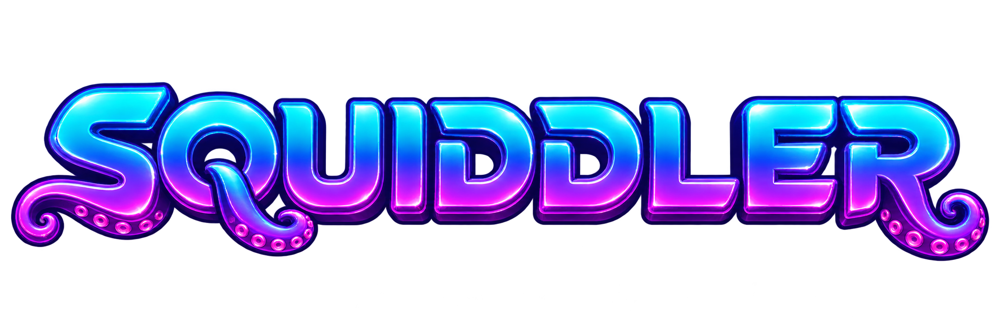
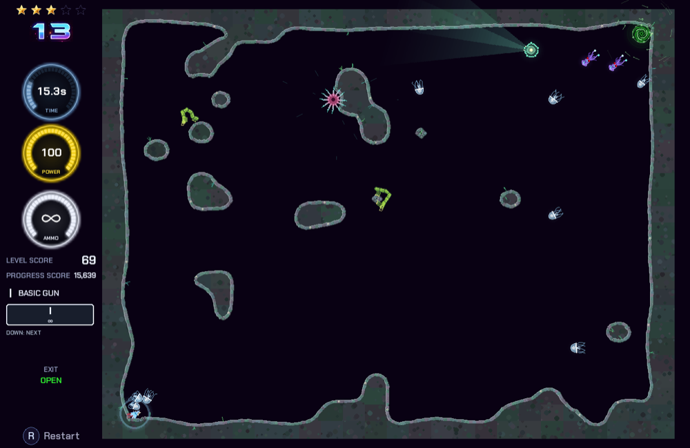
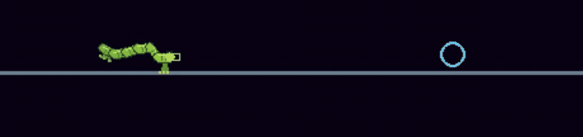
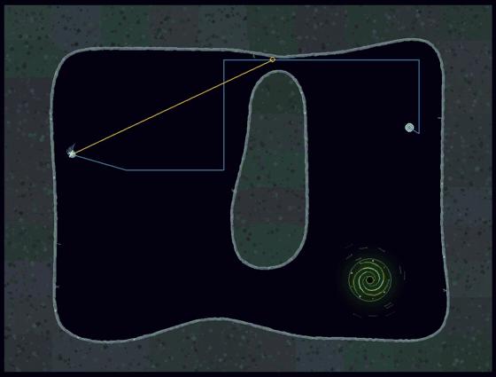
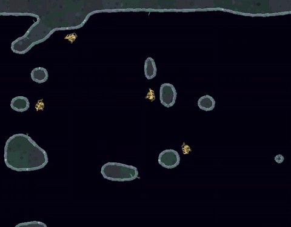
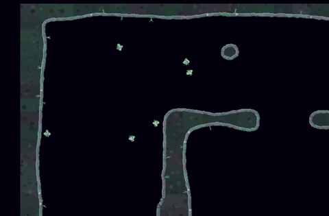
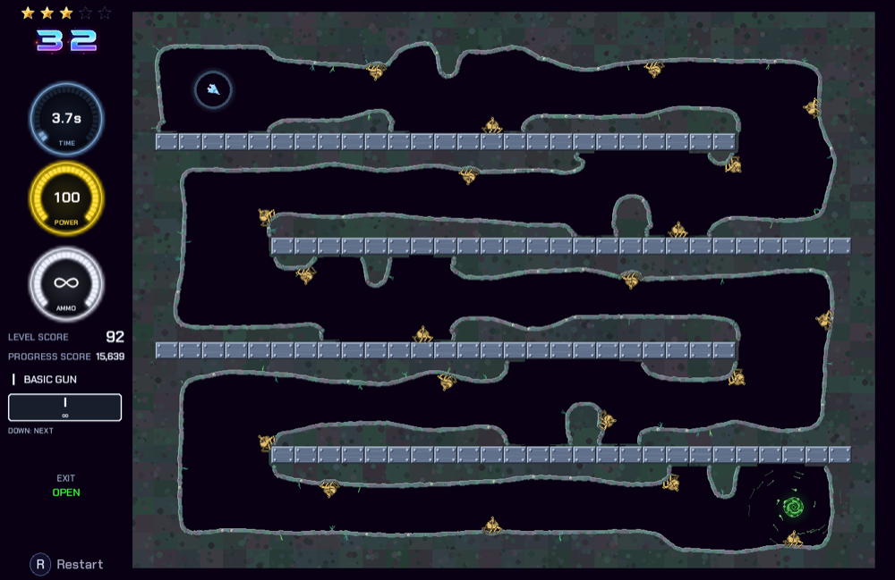

<p align="center">
  
</p>

<p align="center"><b>A momentum-flight cave shooter whose creatures learned to hunt you on their own.</b></p>

Fly a little ship through curved, destructible caves with Asteroids-style momentum: rotate, thrust, drift, shoot. Reach the exit before your power runs out.

The caves are full of artificial life. Most of the creatures you'll meet aren't scripted. They're driven by **small neural networks that were trained, not written**. Each species was put through thousands of practice encounters and rewarded for catching prey, staying alive and working as a team, until its own ways of moving and fighting emerged. Nobody told the Jellies to flank you or the Inchworms how to walk. They worked it out.

<p align="center">
  
</p>

## Meet the creatures

| | |
|---|---|
|  | **Inchworm**: a six-link physical body with five motorised joints, simulated with real physics. Its brain had to discover how to walk, rear up, turn round, bridge gaps and bite. It eats everything except other inchworms, including you. |
|  | **Jelly**: fragile, fast and never alone. Each Jelly carries its own memory, and in teams they learned to route round rock and close in from different sides. |
|  | **Wallcrawler**: a gun on twelve legs that walks on rock and steel, leaps between walls and lines up its shots. Knock it loose and it tumbles. |
|  | **Flocker**: birds with real aerodynamic flight, a swivelling head that aims their shots, and learned signals to the rest of the flock. They perch on walls between attacks. |

There are also **Vibers**, ships flown by a neural pilot, plus a supporting cast of scripted Urchins, Crabs, Belemnites, Anemones, Eggs, Flighthouses and the Squiddler bosses. And not every brain is against you: grab an **ally beacon** and a hunter ship flown by the same trained pilot joins your side.

<p align="center">
  
</p>

## Play

**Download** the macOS (Apple Silicon) or Windows build from the [Releases page](https://github.com/bazmatic/astrovoid/releases), unzip it and run `Squiddler`. On macOS the first launch may need right-click → **Open**, because the app isn't signed.

**Or run from source** (Python 3.10–3.13; 3.13 is recommended):

```bash
git clone https://github.com/bazmatic/astrovoid.git
cd astrovoid
python3.13 -m venv venv
venv/bin/pip install -r requirements.txt
./run.sh                      # Windows: venv\Scripts\python main.py
```

### Controls

| Action | Keyboard | Controller |
|---|---|---|
| Rotate | ← → or A D | Left stick |
| Thrust | ↑ or W | L / ZL |
| Fire | Space | B / R / ZR |
| Next weapon | ↓ or S | A |
| Restart level | R | Y |
| Pause / quit | Esc | |

Keys and buttons can be remapped in **Settings**. Clear 24 designed levels, then keep going in an endless game. Each level awards up to five stars. [How to play](docs/gameplay.md) covers weapons, stars, walls and the rest.

## Develop

```bash
venv/bin/python -m pytest tests/                       # run the tests
WINDOWED=1 START_LEVEL=13 NO_POWER_DRAIN=1 ./run.sh    # jump to a level in a window, with no time pressure
LEVEL_EDITOR=1 ./run.sh                                # adds an EDITOR item to the main menu
```

The game itself needs only pygame, numpy and pymunk. The trained brains ship as small `.npz` files in [assets/neural/](assets/neural/) and run on NumPy. PyTorch is needed only to train new ones:

```bash
venv/bin/pip install -r requirements-train.txt
./run-trainer.sh              # opens the training manager in your browser
```

| Read this | For |
|---|---|
| [Developer guide](docs/development.md) | Setup, troubleshooting, launch switches, project layout, configuration, building releases |
| [How to play](docs/gameplay.md) | Scoring, stars, weapons, walls, enemies, gates |
| [Level files](levels/README.md) | The level format, the editor's output and how the campaign is paced |
| [Training creatures](docs/modular-training.md) | How the brains are trained: tasks, scenarios, PPO, runs and checkpoints |
| [Neural Jelly](docs/neural-jelly.md) · [Flockers](docs/neural-flockers.md) · [Inchworm](docs/neural-inchworm.md) · [Wallcrawlers](docs/creature-training.md) | Each species: what it senses, what it controls, how it was taught |
| [Hunter ally and trainer](docs/hunter.md) | The ally hunter and its pilots, the training manager, unattended runs |
| [Demo videos](docs/demo-video.md) | Recording clips like the ones above from a training run |
| [ARCHITECTURE.md](ARCHITECTURE.md) · [GLOSSARY.md](GLOSSARY.md) | Code structure and vocabulary |

## License

MIT License. Copyright (c) 2025 Barry Earsman.
