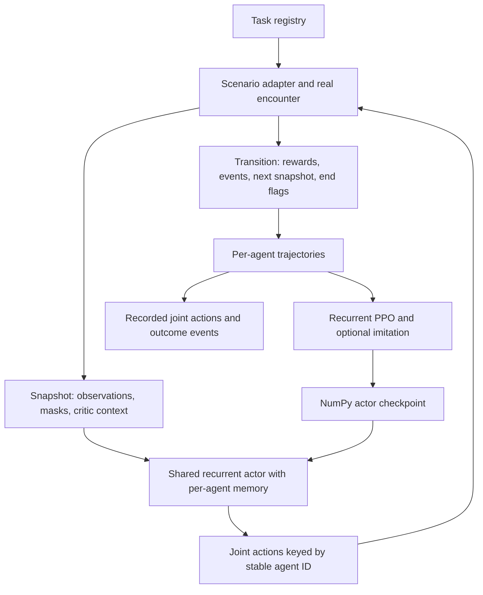

# Modular training system

## How a creature learns

A creature's brain starts out as a small network of random numbers. The trainer drops the creature into real game encounters (the same caves, bodies, physics and guns the player meets) and lets the network drive it. It earns reward for what we want, such as catching prey, hitting targets or surviving a fight, and pays for what we don't, such as dying, getting stuck or wasting shots. After each batch of practice, PPO (a reinforcement learning algorithm, run in PyTorch) nudges the network towards whatever earned more. A curriculum moves the creature on to harder drills once it passes exams on cases it has never practised.

The best network is exported as a small `.npz` file. The game runs it in NumPy, so players never need PyTorch.

One trainer trains every creature. Each creature is a task registered in `learning/tasks.py`, and all of them ship a trained brain in `assets/neural/`:

| Task | Creature | Notes |
| --- | --- | --- |
| `hunter` | The hunter ship's neural pilot (ally, Vibers and Vibelets) | Keeps its own recorder, value model, checkpoint format and CLI path; its numeric adapter also supports the shared stepping interface. A run without a task is a hunter run |
| `jelly_team` | Jellies | [Jelly training notes](notes/jelly-training.md) |
| `flocker_team` | Flockers | [Flocker training notes](notes/flocker-training.md). The shipped brain (run196) was packaged by hand with `tools/promote_flocker.py --accept-without-gate` after its gate failed on cohesion and volleys |
| `wallcrawler_team` | Wallcrawlers | [Wallcrawler training notes](notes/wallcrawler-training.md) |
| `inchworm` | Inchworms | [How the body works](notes/inchworm-body.md); lessons and rewards in `learning/adapters/inchworm_scenario.py` |

The rest of this page is the engineering reference. It uses the wallcrawler team as the worked example unless it says otherwise. A saved run's `config.json` is the authority for that run's rules.

## Module map

| Responsibility | Source | Owns |
| --- | --- | --- |
| Task registry | `learning/tasks.py` | Task keys, adapter imports, defaults, exposed options, replay module and replay hooks module |
| Numeric environment interface | `learning/environment.py` | `Snapshot`, `Transition`, seeded reset, joint action stepping, cleanup |
| Creature adapter | `learning/adapters/wallcrawler.py` | Policy schema, local observations, masks, action translation, critic context, teacher labels, checkpoint migration |
| Scenario adapter | `learning/adapters/crawler_scenario.py` | Actual encounter construction, rewards, cases, metrics, selection, manifest |
| Encounter helpers | `learning/adapters/crawler_curriculum.py`, `practice_targets.py`, `allied_jellyfish.py` | Drill placement, practice targets, pursuers |
| Shot shaping | `learning/adapters/shot_accuracy.py` | Launch-time interception quality |
| Deployed actor | `learning/policy.py`, `continuous.py` | NumPy recurrent inference, categorical and continuous action sampling, versioned checkpoint loading |
| Trainable model | `learning/models.py`, `training.py` | Torch actor conversion, training-only critic, trajectories, initial imitation |
| Optimisation | `learning/ppo.py`, `imitation.py` | Recurrent PPO, advantages, masked losses, optional demonstration rehearsal |
| Initialisation | `learning/initialization.py` | Explicit, one-time actor-head damping |
| Run lifecycle | `learning/run.py` | Worker pool, bootstrap, updates, validation, checkpointing, pause/resume, budgets, final evaluation |
| Operator interface | `tools/trainer/`, `run-trainer.sh`, `tools/ppo_neural.py` | Dashboard, settings, process control, task dispatch |
| Verification and viewing | `learning/replay.py`, `evaluate.py`, `demo.py`, `tools/watch_episode.py` | Exact recorded-action replay, held-out evaluation, live demonstrations |

Production creature traits and physics remain in their normal game modules. The training scenario builds real creatures and advances their normal encounters; changes to aim, recoil, collision, or attachment therefore affect training and must be reflected in reproducibility metadata.

## Data flow



### Environment contract

`reset(seed, **scenario)` returns a `Snapshot`. Its `observations` and `masks` map stable integer agent IDs to numeric inputs and legal controls. `critic` supplies shared training context; optional `agent_critics` supplies focal-agent context. Critic inputs never enter deployed actor inference.

`step(actions)` accepts an ID-to-action-tuple mapping and returns a `Transition`:

- `snapshot`: the next decision's observations and masks.
- `reward`: aggregate scenario reward.
- `agent_rewards`: optional individual credit; the collector falls back to the shared reward when absent.
- `terminated`: a natural end, such as team death or an aiming target clear.
- `truncated`: the horizon interrupted an otherwise continuing trial.
- `events`: cumulative outcome counters and reward components used by metrics and replay.

`close()` releases the encounter. The collector additionally expects `env.adapter.enabled(...)` to identify controls relevant to each actor decision, and `env.action_trace` for replay. These are runtime requirements beyond the minimal `Environment` protocol.

The crawler makes decisions every six simulation frames. Living crawlers share actor parameters, while each keeps its own GRU state and seeded random generator. The collector retains rows for original agent IDs after death, marks them inactive, and masks irrelevant actor losses. Terminal and horizon outcomes remain distinct for value targets.

### Policy contract

`PolicySpec` versions the ordered features, ordered action heads, task name, and continuous heads. Checkpoints include that schema, observation mean/scale, and actor arrays. Loading against an incompatible expected schema fails explicitly.

Crawler schema 5 has categorical `move`, `fire`, `detach`, `landing`, and `message` heads, plus continuous `aim`. A continuous head emits Gaussian mean and log standard deviation; trajectories store the sampled pre-tanh activation, and the creature adapter maps it through tanh to actuator strength. PPO scores the corresponding latent action. Do not replace recorded activations with quantised directions.

Training adds a critic to the Torch network. Export writes only the actor and normalization arrays to `.npz`; gameplay inference uses NumPy and does not require Torch. The crawler loader also accepts the supported legacy schema 4. Transfer to schema 5 explicitly migrates its old aim head while retaining the other compatible arrays; it is not arbitrary schema migration.

## Run lifecycle and artifacts

A new run loads compatible source weights or creates a random actor, copies the opponent into the run, and records rules and arena definitions. Optional teacher trajectories warm-start selected heads. PPO then samples training cases, collects trajectories in spawned workers, updates the network, exports a checkpoint, and records actions and outcomes. Validation runs every five iterations, including iteration zero, and updates `best.npz` only when its selection score improves.

Iteration records describe rollouts from the **previous** policy: `episodes/iterNNNN.json` names that policy, while `iterNNNN.npz` contains the actor after the update. Use the recorded joint actions to reproduce what happened during collection.

| Artifact inside a run | Meaning |
| --- | --- |
| `config.json` | Arguments, task, rules manifest, schema, arenas, opponent hash, reward definitions |
| `opponent.npz` | Frozen opponent copy used by workers and replay |
| `initial.npz`, `bootstrap.npz` | Actor before and after optional initial imitation |
| `demonstrations.pt` | Saved teacher trajectories for optional rehearsal |
| `iterNNNN.npz`, `best.npz` | Updated actors and validation-selected actor |
| `episodes/bootstrap.json`, `episodes/iterNNNN.json` | Cases, seeds, joint action traces, outcome events |
| `resume.pt` | Training network including critic, optimiser, random states, next iteration, team size, battle curriculum evidence, elapsed budget, best score |
| `train.log` | Iteration metrics and optimisation statistics |
| `state.json` | Explicit lifecycle state when written by the trainer |
| `evaluation.json` | Final held-out comparisons, or an incomplete-budget report; both record `selection_gate_passed`, false when no checkpoint passed `selection_score` and `best.npz` is only the fallback policy |

Runs live under `.astrovoid-local/neural/rl/runN`. Process output is also captured in the sibling `runN.log`.

**Resume** restores the same run, including optimiser and random states, and requires its recorded manifest to match. **Continue from a checkpoint** starts a new run with compatible actor weights and a fresh critic/optimiser; it permits a new scenario manifest. Use continuation after reward or physics changes. Ordinary continuation does not damp weights. `--actor-scale` is an explicit one-time new-run operation, not an inherited setting.

`budget_seconds=0` disables the wall-clock limit; `iterations=0` disables the iteration limit. Bounded runs reserve `min(600 seconds, budget/6)` for final evaluation. Bootstrap and validation consume the same budget. The hard deadline can stop rollout workers and leave evaluation incomplete. Pausing saves at the end of an iteration; stopping preserves existing checkpoints. Final held-out evaluation follows normal loop completion, not a pause.

## Operating the trainer

Open the dashboard with `./run-trainer.sh`; its default address is `http://localhost:8765`. Only one run may be active or paused. The timing label reports the last completed iteration, not a live countdown. During final evaluation the header says Evaluating and the iteration count stays fixed; Finishing means results are saved and workers are shutting down.

```sh
# Inspect the active run and saved runs.
./run-trainer.sh status
./run-trainer.sh runs

# Example bounded fresh crawler run.
./run-trainer.sh start --from new --set task=wallcrawler_team \
  --set workers=4 --set episodes=12 --set horizon=60 \
  --set iterations=100 --set budget_seconds=7200

# Save at an iteration boundary, then restore the same run.
./run-trainer.sh pause
./run-trainer.sh resume

# Stop before starting another run. Replace the example source with your checkpoint.
./run-trainer.sh stop
./run-trainer.sh start --from run142/iter0576 --set task=wallcrawler_team
```

Settings can carry forward from the source run. Inspect the new `config.json` instead of assuming fresh defaults. These commands are operational examples; writing this guide does not restart or modify a running session.

### Replay and evaluation

Use the dashboard's recorded episodes, or these commands with an actual run and episode:

```sh
# Validate replay compatibility, then watch episode zero from iteration zero.
venv/bin/python -m tools.watch_episode .astrovoid-local/neural/rl/run144 0 0 --check
venv/bin/python -m tools.watch_episode .astrovoid-local/neural/rl/run144 0 0 --speed 1

# Re-evaluate best.npz on the fixed held-out practice suite.
venv/bin/python -m learning.evaluate .astrovoid-local/neural/rl/run144 --workers 4
```

Replay is task-agnostic. `learning.replay` reads the task key from the run's `config.json` and asks that task's replay hooks module (`Task.replay_hooks`) to check the saved manifest against current rules and build the environment; it then applies the recorded joint actions and compares cumulative events exactly. Restoring the saved arena definitions and the frozen opponent is crawler-only (`learning/adapters/crawler_replay.py`); the Jelly hooks live in `learning/adapters/jelly_replay.py`. `learning.replay.fly(path, iteration)` returns each episode's outcome totals, which the task's `outcome` hook shapes; for crawlers this includes reconstructed reward totals for reconciliation with `agent_returns`. See [Replay hooks](replay-hooks.md) for the contract. Old recordings may require their original code revision after physics or reward changes; saved actions alone do not preserve an old simulator.

Evaluation compares trained, scripted, and muted-radio policies. `--suite pursuit` also compares jumping disabled; `--suite ships` exercises the ship scenarios. Evaluation copies the chosen actor to a hash-named checkpoint so concurrent training cannot change its weights halfway through comparison. A fresh evaluation or `learning.demo` is not the historical recorded rollout. Training does not automatically install its exported actor into the campaign.

## Adding or changing a task

1. Define a versioned `PolicySpec` and creature adapter: observations, legal masks, action translation, and an `enabled` function aligned with head order. Keep privileged critic context out of actor features.
2. Implement an environment with seeded `reset`, joint `step`, and `close`, plus the collector's adapter and action-trace hooks. Use stable agent IDs and return individual credits when appropriate.
3. Supply the scenario hooks consumed by `learning/run.py`: `SPEC`, `CRITIC_SIZE`, `INITIAL_STAGE`, `IMITATION_HEADS`, `environment`, `metadata`, `training_cases`, `validation_cases`, `evaluation_cases`, `metrics`, `selection_score`, `promote`, and `compare`. Teacher mode additionally needs `env.adapter.teacher_action`. Optional rehearsal settings follow the crawler adapter's example; `load_transfer_policy` is optional.
4. Register the task key, adapter module, defaults/options, and, to make its episodes replayable, `replay_module='learning.replay'` plus `replay_hooks` in `learning/tasks.py`. The hooks module implements `open_environment(path, manifest)`; `episode`, `outcome`, `draw`, `status`, and `metadata_args` are optional (see [Replay hooks](replay-hooks.md)). Check CLI and dashboard support for any new task-specific controls; hunter intentionally retains a special legacy dispatch path.
5. Record every behaviour-affecting rule in the manifest. Bump the scenario version when rewards or encounter rules change; bump the policy schema when feature order or action semantics change. Add an explicit transfer loader only when migration is well defined.
6. Verify a short collection/update, Torch-to-NumPy actor parity, legal controls, deterministic cases and replay, terminal versus horizon handling, and individual versus aggregate reward accounting. Resume must reject incompatible rules. A new checkpoint continuation should preserve compatible arrays unless a requested migration or damping operation changes them.

For a reward-only change, edit the scenario rather than PPO or production creature traits. For a new creature ability, implement production mechanics first, then expose the appropriate observation, mask, and actuator through its adapter. Preserve separate training, validation, and held-out cases when extending the curriculum.

Relevant checks include `tests/test_creature_learning.py`, `test_continuous_aim.py`, `test_aim_curriculum.py`, `test_relearning_rewards.py`, `test_firing_recoil.py`, and the trainer control/settings/page tests. Headless game tests use `SDL_VIDEODRIVER=dummy SDL_AUDIODRIVER=dummy`.
