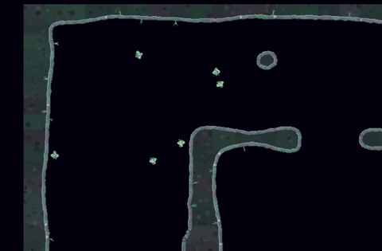

# The Flocker

Flockers are small birds that hunt in flocks of up to eight. They fly like real birds, swivel their heads to aim, perch on the cave walls to rest, and call to each other in a language they made up themselves.

## Flying like a bird

A Flocker can't stop dead or fly backwards. It flies forward and turns in arcs: the faster it goes, the wider it has to turn, and at low speed it can barely steer at all. Ease off the throttle and it glides. Hit a wall hard and it flaps wildly for a moment.

Its head turns separately from its body, up to 90° either way, and its shots come out of its mouth wherever the head is pointing. So a Flocker can fly one way and shoot another.

When there's nothing to hunt, a Flocker can glide gently up to a wall, fold its wings and perch there, breathing quietly until something comes into view.

## A language of their own

Each Flocker can make one of eight calls, or stay silent. Nobody told them what the calls mean. Their meaning, if any, is whatever turned out to be useful during training. Birds hear calls from up to 300 pixels away.

A Flocker that spots you can also raise the alarm: nearby birds learn roughly where you were, and perched birds take off.

## Flight school

Flockers trained in six stages:

1. **Stick together.** Fly as a group and regroup when scattered. Birds are rewarded for flying the same way as their neighbours, so flocking isn't hard-coded; it pays.
2. **Search and rest.** Prey comes and goes. Hunt when it's there and perch when it's not.
3. **Aim.** Hit targets moving at different speeds with that swivelling head.
4. **Volleys.** Several birds firing at the same target at the same moment, with a bonus if the volley lands.
5. **Fight a real opponent.** A ship flown by the game's neural hunter pilot, with its bullets weakened.
6. **Fight it for real.** Full-strength bullets.

The brain in the game passed most of its exams but not all of them. Its flocking and volleys still fall short of the targets set for it, and it was put in the game anyway. The flock is still learning to stay together.

## Meet them

Flockers arrive on level 5 and come as full flocks on levels 8, 10, 15, 18, 20 and 23. **Flighthouses** sweep the cave with a searchlight and launch more Flockers when they spot you. Shoot the lighthouse first.

## Under the hood

Each bird runs the same recurrent network (about 30,000 numbers in `assets/neural/flocker.npz`) with its own memory. It sees walls, up to four targets and its eight nearest flock-mates, and chooses its turn, throttle, head angle, when to fire, which target, what to call and whether to perch. The full detail is in [the Flocker training notes](notes/flocker-training.md).
