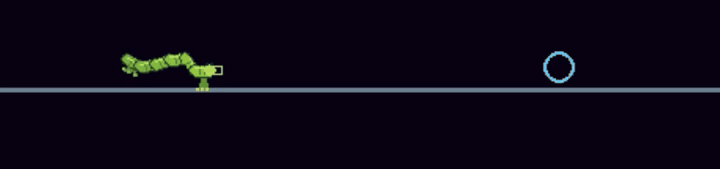

# The Inchworm

<p align="center"></p>

The Inchworm is a hungry green worm that walks along cave walls, rears up when you come close, and bites. It will eat anything that isn't another inchworm: Crabs, Jellies, your hunter ally, and you.

Nobody programmed it to walk. It taught itself.

## A real body

An Inchworm is six rigid segments joined by five muscles, with a pair of grabbing feet at each end. It's simulated with real physics: mass, momentum, joint limits and feet that can slip if pulled too hard. There's no gravity in the caves, so a worm that lets go of the wall with both ends just drifts away.

Its brain can only do what a worm can do: tighten or relax each of its five muscles, grip or release with each pair of feet, and bite. There is no "walk forward" button and no "turn around" button. Walking, turning and climbing are all things it had to figure out from twitching its muscles at the right moments.

## Going to school

The worm learned in a series of lessons. Each one was a little exam, set with targets it had never seen, and it had to pass 80% of them before moving on.

| Lesson | The challenge |
|---|---|
| Crawl | Get to a marker a few body lengths away |
| Rear | Lift your head up to something overhead |
| Curl | Bend back over yourself without letting go of the wall |
| Turn | Swing your head round to something behind you |
| About-face | Turn your whole body round and walk the other way |
| Gap | Step across a gap to another rock |
| Reach | Hold your mouth on prey above you |
| Feed | Land two real bites |
| Recover | Get shoved off, find your footing, and bite again |

At first a scripted "teacher" worm showed it roughly how to move. Later the teacher was switched off and the worm improved by trial and error, rewarded for progress and penalised for dawdling, falling off or flailing.

## Things it did that nobody expected

- **It learned to leap.** We fined it for being slow on the Crawl lesson, hoping it would walk faster. Instead it found it could fling itself through the air, spending a quarter of its time off the ground. After hundreds of training rounds of it refusing to stop, leaping was declared legal.
- **It turned round on its own.** About-face (curl back, flip the front feet over, plant them, unfold the other way) was the hardest lesson. The final version learned it with no teacher at all.
- **It's better at gaps than its teacher.** The hand-written walking routine crossed gaps between rocks only by luck, 8 times in 40. The trained worm crosses 83% of them.
- **Cornering a worm broke physics.** A worm placed in a narrow dead end jammed its arch so hard that the physics solver blew up. Now a worm that breaks the solver gets reset, and after three resets it dies. The levels give worms open floor.

When an Inchworm dies, it lets go of everything and curls up into a spiral.

## Meet one

Inchworms hunt in pairs on levels 13, 16, 19, 22, 26 and 29. For a closer look, level 33 is an arena with four of them and unlimited ammo:

```bash
START_LEVEL=33 ./run.sh
```

Get near a head to make it rear and feed. Shoot or shove a worm to break its grip.

## Under the hood

The brain is a small recurrent neural network with a short-term memory, about 23,000 numbers in `assets/neural/inchworm.npz`. It makes 10 decisions a second, from its own joint angles, grips, wall feelers and whatever it can see. `INCHWORM_POLICY=` (set empty) swaps in the old scripted walk.

For the engineering detail, see [how the body works](notes/inchworm-body.md). The lessons and rewards are defined in `learning/adapters/inchworm_scenario.py` and `learning/inchworm_rewards.py`.
