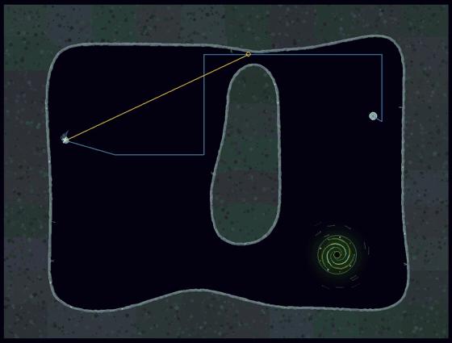

# The Jelly

Jellies are small, fragile and quick. One shot kills one, but they never come alone, and one touch hurts. Every Jelly in the campaign is driven by a trained neural network.

## What a Jelly knows

A Jelly's world is simple. It can feel how far the walls are in every direction, it knows which way it's facing and how fast it's going, and it can see its prey (you, or your hunter ally) and up to four other Jellies nearby.

Jellies can't talk to each other. Whatever teamwork they show, they worked out just by watching where the others are.

All a Jelly can do is pick a direction and decide how hard to swim or brake. It turns at a limited rate, and braking slows it but never sends it backwards.

## Growing up

Jellies learned in real cave levels, in three stages:

1. **Hunting alone.** A single Jelly chases a drifting target round the caves. Touch it and it reappears somewhere else, so the Jelly has to find it again, and again. Getting stuck against a wall costs it.
2. **Hunting as a pack.** Teams of two to four. Everyone shares the reward for a catch, there's a bonus for closing in from different sides, and Jellies that bunch together are penalised.
3. **Hunting something that shoots back.** The target is now a ship flown by the game's own neural hunter pilot, and it fights back. Jellies are rewarded for hurting it and killing it, and penalised for dying.

They were tested on three cave levels they never trained on, so they couldn't just memorise the route.

A brand-new Jelly brain mostly sits still and does nothing; it has no idea that moving gets results. Everything it does in the game, it learned.

## How good are they?

The trained Jellies catch their prey slightly more often than the old scripted ones (5.3 catches a minute against 5.0), and they're far better at not getting stuck: wedged against rock 4% of the time, against the scripted Jelly's 21%.

## Meet them

Jellies first appear on level 3, and whole swarms hunt on levels 6, 9, 13, 19, 22 and 29. Level 13 has them alongside Inchworms, which will happily eat them.

To compare with the old scripted Jellies, run `SCRIPTED_JELLIES=1 ./run.sh`.

## Under the hood

Each Jelly runs the same small recurrent network (about 21,000 numbers in `assets/neural/jelly.npz`) with its own memory, deciding several times a second. The details of the training stages, rewards and how a brain is chosen are in [the Jelly training notes](notes/jelly-training.md).
