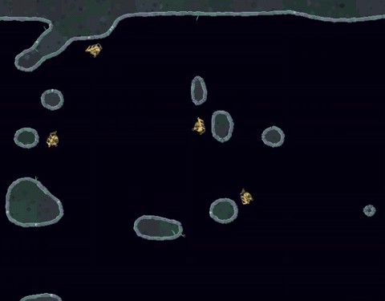

# The Wallcrawler

A Wallcrawler is a gun on twelve little legs. It walks along rock and metal walls, swings its turret round to aim, and leaps across open space to reach another wall. Wallcrawlers hunt in gangs and talk to each other by radio.

## Walking, leaping, landing

On a wall, a Wallcrawler scuttles along the surface and aims anywhere in the open half of the cave in front of it.

To change walls it crouches, pushes off with its legs and launches itself across the gap. Once it's in the air there's no steering: it flies wherever the push sent it, spinning as it goes. As it nears the far wall its legs reach out, magnetic feet pull it into line, and its legs soak up the impact like springs.

It can still shoot while flying, and every shot kicks it backwards. Nobody gave it a way to steer in mid-air, but its gun's recoil works as one if it learns to fire in the right direction at the right time.

Hit it with a bullet or an explosion and it's knocked loose, stunned and tumbling, unable to fire until it lands again.

## Radio

Wallcrawlers can broadcast one of eight signals, or stay silent, to others within 300 pixels. Radio passes straight through rock. The signals have no built-in meaning. The crawlers can make up their own, and whether they're really saying anything useful to each other is still an open question.

## Boot camp

Wallcrawlers trained in two kinds of drill, over and over:

- **Target practice.** Pairs of crawlers learning to hit targets, first standing still and then moving. Every hit scores, every shot costs a little, so spraying bullets doesn't pay.
- **Battles.** Gangs of four against Jellies and a ship flown by the neural hunter pilot. Crawlers earn reward for staying alive, for surviving the whole battle and for killing Jellies, and they lose a lot for dying.

As with the other creatures, the final exams were held on cave levels the crawlers had never trained on.

## Meet them

Wallcrawlers first appear on level 11, as a gang of five. They return in growing numbers through the campaign, and level 32 is a long switchback lined with twenty of them.

## Under the hood

Every crawler runs the same recurrent network (about 27,000 numbers in `assets/neural/wallcrawler.npz`) with its own memory. It decides 10 times a second whether to walk, aim, fire, leap, where to land and what to say. `WALLCRAWLER_POLICY=` (set empty) brings back the scripted crawler.

How the training evolved, scenario by scenario, is in [Creature training](creature-training.md), and the training system itself is in [Modular training](modular-training.md).
